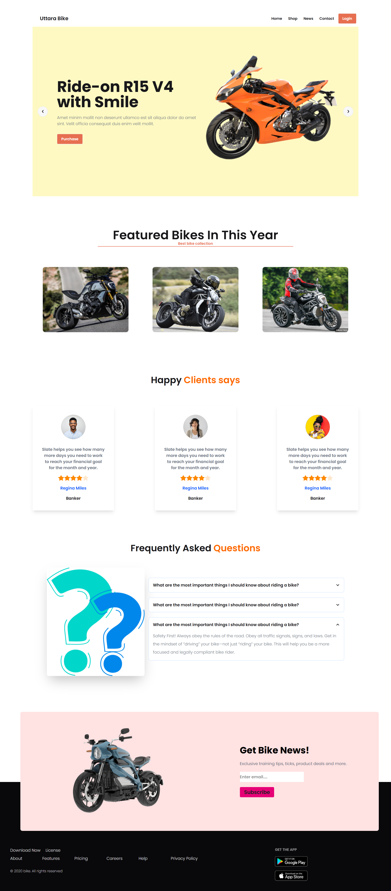

# 🚴 Uttara Bike

A responsive bike shop landing page built with **HTML**, **Tailwind CSS**, and **DaisyUI**.

---

## 📸 Full Screen Preview


---

## 🚀 Live Demo

🔗 [View Live Site](#) *(https://iseyamin.github.io/uttara-bike/)*

---

## ✨ Features

- 🎠 Hero carousel with 3 slides and prev/next navigation
- 🏍️ "Featured Bikes of the Year" showcase section
- ⭐ Customer reviews with star ratings
- ❓ FAQ section using DaisyUI accordions
- 📬 Newsletter subscription box in the footer
- 📱 Fully responsive (mobile, tablet, desktop)
- 🔤 Clean typography with the Poppins Google Font

---

## 🛠️ Built With

| Tool | Purpose |
|------|---------|
| 🌐 HTML5 | Page structure |
| 🎨 Tailwind CSS v4 | Utility-first styling |
| 🌼 DaisyUI v5 | Ready-made UI components |
| 🔠 Google Fonts (Poppins) | Typography |

---

## 📁 Project Structure

```
uttara-bike/
├── 📄 index.html
├── 📄 README.md
└── 📂 images/
    ├── 📂 slider/    # bike1.png – bike4.png
    └── 📂 others/    # latest, users, faq, app badges
```

---

## 🚀 Getting Started

1. 📥 **Clone the repository**
   ```bash
   git clone https://github.com/your-username/uttara-bike.git
   ```
2. 📂 **Open the folder**
   ```bash
   cd uttara-bike
   ```
3. 🌍 **Open `index.html`** in your browser

> 💡 No build step needed. Tailwind and DaisyUI load through CDN, so an internet connection is required.

---

## 🎨 Color Palette

| Color | Hex | Usage |
|-------|-----|-------|
| 🟠 Primary | `#E76F51` | Buttons, highlights |
| 🔴 Light Red | `bg-red-100` | Slide & newsletter background |
| 🟡 Light Yellow | `bg-yellow-100` | Slide background |

---

## 📱 Sections

1. 🧭 Navbar
2. 🎠 Hero Carousel
3. 🏆 Featured Bikes
4. 💬 Happy Clients
5. ❓ FAQ
6. 🔗 Footer + Newsletter

---

## 🔮 Future Improvements

- [ ] 🛒 Add a working shop page
- [ ] 🔐 Add a login page
- [ ] 🌙 Dark mode toggle
- [ ] ♿ Improve accessibility (alt text, labels)
- [ ] ⚡ Optimize images and fonts

---

## 🤝 Contributing

Contributions, issues, and feature requests are welcome! 🙌

1. 🍴 Fork the project
2. 🌿 Create your branch (`git checkout -b feature/amazing-feature`)
3. 💾 Commit your changes (`git commit -m "Add amazing feature"`)
4. 📤 Push to the branch (`git push origin feature/amazing-feature`)
5. 🔁 Open a Pull Request

---

## 📄 License

Distributed under the MIT License. 📜

---

## 👤 Author

**Your Name**
- 🐙 GitHub: [@iseyamin](https://github.com/iseyamin)
- 📧 Email: israfil241-15-575@diu.edu.bd

---

⭐ If you like this project, give it a star! Happy riding! 🚴‍♂️💨
